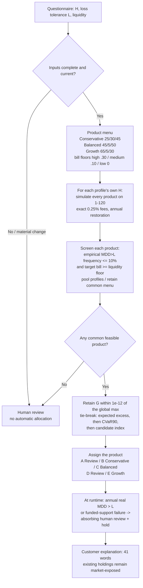

# Q1 — one-page onboarding decision flow

This is the task-facing suitability flow. It uses the frozen V2b registry products
and the declared empirical screen; it does not change any assignment. The exact
tie-break is recorded in [service_refinement_readiness_review.json](../docs/service_refinement_readiness_review.json)
and [joint_liquidity_refit_protocol.json](../docs/joint_liquidity_refit_protocol.json).

## Flow

## Decision trace, full development 1–120

| Profile | H | L | Liquidity | Risk-feasible | Liquidity-feasible | Joint-feasible | Menu candidates | Assignment |
| --- | ---: | ---: | --- | ---: | ---: | ---: | ---: | --- |
| A | 5 | 10% | High | 0 | 92 | 0 | 0 | **Review** |
| B | 15 | 25% | Medium | 52 | 154 | 52 | 1 | **Conservative** |
| C | 30 | 40% | Low | 93 | 172 | 93 | 2 | **Balanced** |
| D | 25 | 15% | Medium | 0 | 154 | 0 | 0 | **Review** |
| E | 6 | 35% | High | 157 | 92 | 92 | 3 | **Growth** |

The counts are full-development feasibility counts from
[q1_context_assignments.csv](../results/model_review/joint_liquidity_refit_v1/q1_context_assignments.csv).
They explain why A/D are Review: no product passes the risk screen even though
some pass the liquidity floor. B/C/E have one or more common-menu candidates.

## Selection logic in words

1. **Inputs.** Use the questionnaire horizon, loss tolerance and liquidity need.
   A missing or materially changed cash need is a review trigger, not an invented
   withdrawal amount.
2. **Product menu.** The three products are fixed targets; the bill floor is a
   normative target convention, not a live cash reserve.
3. **Training screen.** For each profile's own horizon, evaluate the finite
   product menu on original 1–120 with exact fees and annual target restoration.
   Keep only products whose empirical real-MDD exceedance frequency is at most
   10% of the training paths and whose target bill meets the liquidity floor.
4. **Common menu.** Pool the profile evidence and retain products that are
   jointly feasible for the common menu. No product is forced onto a profile.
5. **Ranking.** Among the retained set, keep products whose training growth is
   within `1e-12` of the global maximum; then minimize expected loss excess,
   then CVaR90, then the declared candidate index. This is a transparent
   finite-menu rule, not a claim of global optimality.
6. **Assignment and runtime.** A/D get Review. B/C/E get the selected product.
   At runtime, a real annual MDD above the customer's L, or a funded-support
   failure, creates an absorbing human review/hold. The app does not invent an
   adviser response or a recovery reset.

## The honest caveats

- The 10% screen is a **declared service reference**, not a contest mandate or a
  customer guarantee. It is an empirical training screen, not a calibrated
  conditional probability.
- On the final 121–180 sample, B/C static frequencies rise above 10% and E Growth
  has negative P10 growth. These adverse outcomes are in
  [Q1_PRODUCT_COMPARISON.md](Q1_PRODUCT_COMPARISON.md) and must be reported.
- The Q1 product references are static annual products, not the Q2 guarded
  service. C's Q2 V2b guard reduces breaches to 2/60; that does not retroactively
  change the Q1 static table or turn A/D into investable products.
